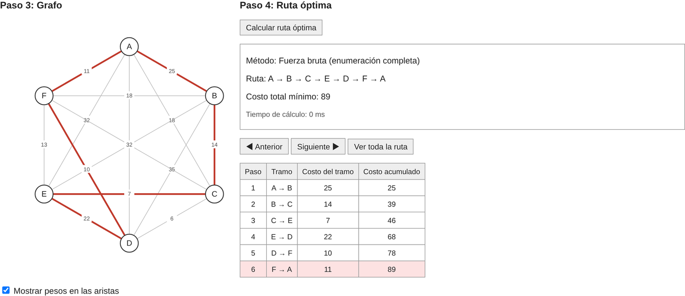
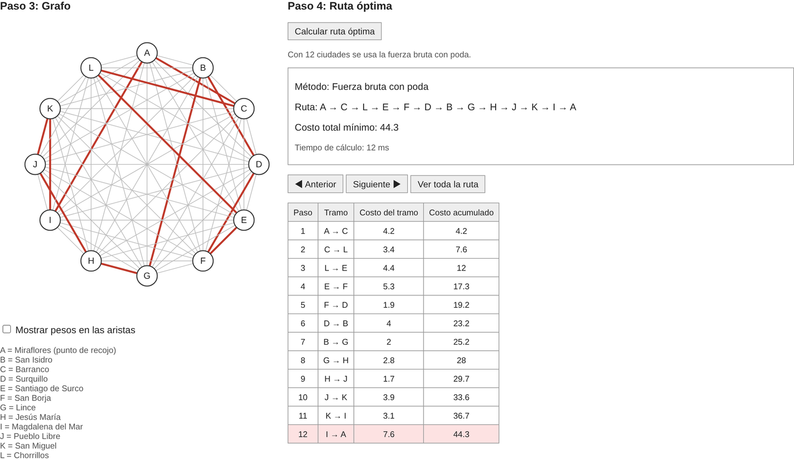
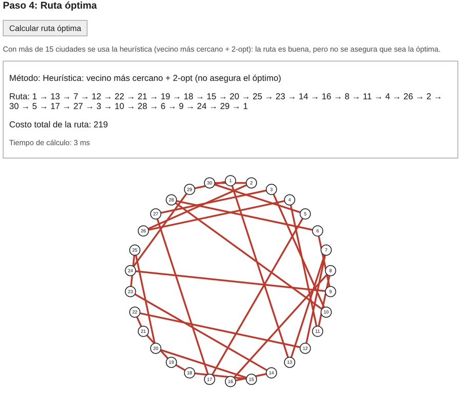

# Problema del agente viajero (TSP)

Aplicación web que encuentra la ruta más corta para visitar un conjunto de ciudades una sola vez y volver al punto de partida. Se usa desde el navegador, sin instalar nada.

**Abrir el programa:** https://blafyy.github.io/agente-viajero/

## Qué hace

- Arma un grafo ponderado completo de **5 a 100 ciudades**.
- La matriz de costos se genera al azar, se escribe a mano (hasta 15 ciudades) o se carga desde el caso de estudio de Rappi.
- Calcula la ruta y muestra el método usado, el costo total y el tiempo de cálculo.
- Resalta la ruta en el grafo y muestra una tabla con el costo de cada tramo y el costo acumulado.
- Permite recorrer la ruta **paso a paso**, tramo por tramo.

## Métodos

El programa elige el método según el número de ciudades:

| Ciudades | Método | ¿Asegura la ruta óptima? |
|---|---|---|
| 5 a 8 | Fuerza bruta (prueba todas las rutas) | Sí |
| 9 a 15 | Fuerza bruta con poda (descarta las rutas que ya no pueden mejorar) | Sí |
| 16 a 100 | Heurística: vecino más cercano + 2-opt | No, pero da una ruta buena en milisegundos |

## Cómo usarlo

1. Escribe el número de ciudades y presiona **Construir**, o presiona **Caso de estudio Rappi**.
2. Elige **Generación automática** o **Ingreso manual** para la matriz de costos.
3. Revisa el grafo. La casilla *Mostrar pesos en las aristas* muestra el costo de cada arista.
4. Presiona **Calcular ruta óptima**.
5. Usa **Anterior** y **Siguiente** para ver la ruta tramo por tramo, o **Ver toda la ruta** para verla completa.

## Caso de estudio: reparto de Rappi en Lima

Un repartidor recoge 11 pedidos en Miraflores y los entrega en 11 distritos de Lima. Con el botón **Caso de estudio Rappi** el programa carga las distancias aproximadas en km y encuentra la ruta óptima de **44.3 km**. Entregar en el orden de la lista costaría 72.9 km.

## Casos grandes

Con más de 15 ciudades la matriz no se muestra en pantalla y el grafo se dibuja solo con la ruta. El programa avisa que usa la heurística.

## Ejecutarlo en tu computadora

Descarga el repositorio (botón **Code → Download ZIP**), descomprímelo y abre `index.html` en cualquier navegador.

## Archivos

| Archivo | Contenido |
|---|---|
| `index.html` | Estructura de la página |
| `style.css` | Estilos |
| `script.js` | Lógica: matriz, grafo, fuerza bruta, poda, heurística, paso a paso y caso Rappi |
| `capturas/` | Imágenes de este README |

## Proyecto

Proyecto del curso MA475 Matemática Computacional, Universidad Peruana de Ciencias Aplicadas (UPC), 2026. Grupo 2:

- Becerra Ninahuanca, Luis Angel
- De la Cruz Quispe, Roman Romanovich
- Ortega Calderon, Cristopher Jesus
- Palomino Corrales, Alvaro Kevin
- Villamar Rojas, Santiago Augusto
